# 脑出血 RAG 平台：功能实现方案与架构图

> 基于 `F:\Medical-RAG` 当前代码快照分析  
> 分析日期：2026-10-26  
> 范围：Knowledge、Agent、Evaluation 三套前后端，以及集成部署、数据存储、任务队列、监控与测试

## 1. 结论摘要

当前项目已经形成“知识生产 → 循证问答 → 批量测评”的完整业务闭环，采用 6 个独立业务项目和 1 个部署项目：

| 领域 | 前端 | 后端 | 核心职责 | 当前实现状态 |
| --- | --- | --- | --- | --- |
| Knowledge | `medical-knowledge-web` | `medical-knowledge-api` | 文献、解析、分块、嵌入、混合检索、MCP | 主链路已实现 |
| Agent | `medical-agent-web` | `medical-agent-api` | 会话、模型、MCP 工具循环、引用与核验 | 主链路已实现，语义核验存在代码/测试漂移 |
| Evaluation | `medical-evaluation-web` | `medical-evaluation-api` | 题库、证据出题、批量测试、三层评分 | 主链路已实现，目前同步执行 |
| Deploy | — | `medical-platform-deploy` | Nginx、3 API、3 Web、3 PostgreSQL、Qdrant、Redis、Prometheus | Compose 集成已实现 |

架构上的关键设计是：

- 三个业务后端各自拥有独立 PostgreSQL，不跨库读写。
- Evaluation 仅通过 HTTP 调用 Knowledge 与 Agent。
- Agent 仅通过 MCP 获取知识证据，不直接连接知识库数据库或 Qdrant。
- Knowledge 使用 PostgreSQL 保存业务元数据和可回滚的 Chunk 快照，Qdrant 保存向量索引。
- PDF 转换、模型下载、索引构建、证据抽取通过 PostgreSQL 持久化任务队列执行。
- 检索采用 Dense + BM25 + RRF，可选 Cross-Encoder 重排；Qdrant 故障时退化到 PostgreSQL 内嵌向量余弦计算。

## 2. 系统总体架构

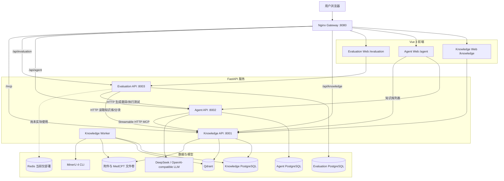

### 2.1 服务边界

| 服务 | 对外入口 | 持久化 | 主要依赖 |
| --- | --- | --- | --- |
| Knowledge API | `/api/knowledge/*`、`/mcp/` | Knowledge PostgreSQL、文件卷、Qdrant | MinerU、MedCPT、可选 Cross-Encoder |
| Agent API | `/api/agent/*` | Agent PostgreSQL、Harness 工作目录 | LLM、一个或多个 MCP Server |
| Evaluation API | `/api/evaluation/*` | Evaluation PostgreSQL | Knowledge HTTP API、Agent HTTP API |
| Knowledge Worker | 无 HTTP 入口 | 与 Knowledge API 共用数据库和文件卷 | MinerU、MedCPT、Qdrant |

### 2.2 网关路由

`medical-platform-deploy/nginx.conf` 将统一入口拆分为：

| 路径 | 目标 |
| --- | --- |
| `/knowledge/` | Knowledge Web |
| `/agent/` | Agent Web |
| `/evaluation/` | Evaluation Web |
| `/api/knowledge/` | Knowledge API |
| `/api/agent/` | Agent API |
| `/api/evaluation/` | Evaluation API |
| `/mcp/` | Knowledge MCP；关闭代理缓冲并保留原始 Host |

## 3. 功能全景图

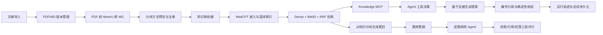

## 4. Knowledge：知识服务

### 4.1 前端工作区

`medical-knowledge-web/src/App.vue` 是共享应用壳，`router.ts` 为五个顶层页面提供稳定 URL：

| 页面 | 路由 | 功能 |
| --- | --- | --- |
| 首页 | `/knowledge/` | 仪表盘、最近文献、服务状态 |
| 文献管理 | `/knowledge/documents` | 条目、附件、预览、移动、删除、PDF 转换 |
| 方法与模型 | `/knowledge/configurations` | 分块方法预览/注册、嵌入模型注册/下载 |
| 知识库管理 | `/knowledge/knowledge-bases` | 创建、构建、检索、Chunk 预览、删除 |
| 解析任务 | `/knowledge/tasks` | 任务轮询、进度、重试、批量移除历史 |

前端直接使用 `fetch` 调用 Knowledge API。只有存在 `queued/running` 任务时才高频轮询；页面不可见时降低频率，无活动任务时停止轮询。

### 4.2 文献条目与附件管理

主要代码：

- API：`medical-knowledge-api/app/api/documents.py`
- 数据模型：`app/models/documents.py`
- 仓储：`app/repositories/documents.py`
- 前端：`medical-knowledge-web/src/App.vue`

具体方案：

1. `Document` 保存题名、DOI、作者、摘要、年份和扩展元数据。
2. `DocumentFile` 保存物理附件元数据，数据库约束确保每个条目最多一份 PDF 和一份 Markdown。
3. 上传采用流式读取，并按 SHA-256 存入 `attachments/<hash-prefix>/<hash>.<ext>`，避免一次性加载大文件并提供全局重复检测。
4. PDF 使用 `pypdf` 读取元数据；Markdown 读取 front matter/文本信息；无法提取时退化到文件名。
5. 路径读取前使用 `resolve()` 和 `is_relative_to(workspace_root)` 防止目录穿越。
6. 支持批量创建条目、向已有条目补附件、附件预览/下载、跨条目移动以及附件/条目删除。
7. 删除文献前检查是否被知识库引用；“删除未受保护文献”只删除没有知识库关联的条目。

主要接口：

| 接口 | 用途 |
| --- | --- |
| `POST /api/v1/documents` | 仅创建文献元数据 |
| `GET /api/v1/documents` | 分页列出文献 |
| `POST /api/v1/documents/from-file(s)` | 从一个或多个文件创建条目 |
| `POST /api/v1/documents/{id}/files` | 向已有条目增加附件 |
| `POST /api/v1/documents/{id}/convert-pdf` | 入队 PDF 转 Markdown |
| `GET /api/v1/documents/attachments/{id}/content` | 预览或下载附件 |
| `POST /api/v1/documents/attachments/{id}/move` | 移动附件 |
| `DELETE /api/v1/documents/{id}` | 删除条目 |

### 4.3 PDF 转 Markdown

主要代码：`app/services/mineru.py`、`app/services/pdf_conversion.py`、`app/services/task_worker.py`。

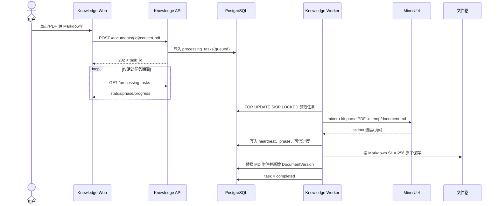

实现细节：

- MinerU 在独立线程中使用 `subprocess.Popen` 运行，避免 Windows 事件循环的子进程兼容问题。
- stdout 由单独读线程消费，完整行通过 `run_coroutine_threadsafe` 回传异步 Worker。
- 只识别明确的百分比或 `current/total` 页码作为进度，不把日志中的普通数字误判为进度。
- 临时目录隔离中间文件；超时或取消时先 terminate，5 秒后升级为 kill。
- 外部解析完成后才开始数据库变更；数据库提交失败时删除本次新建的孤立文件。
- 相同内容转换具备幂等性；跨文献共享同一物理附件被当前所有权模型禁止。

### 4.4 持久化任务队列

主要代码：`app/models/processing_tasks.py`、`app/repositories/processing_tasks.py`、`app/services/task_worker.py`。

支持四类任务：

| `task_type` | 执行器 |
| --- | --- |
| `pdf_to_markdown` | MinerU 转换与版本落库 |
| `knowledge_base_build` | 分块、嵌入、Qdrant 发布 |
| `embedding_model_download` | Hugging Face 下载 MedCPT 双编码器 |
| `evidence_extraction` | 确定性证据候选抽取 |

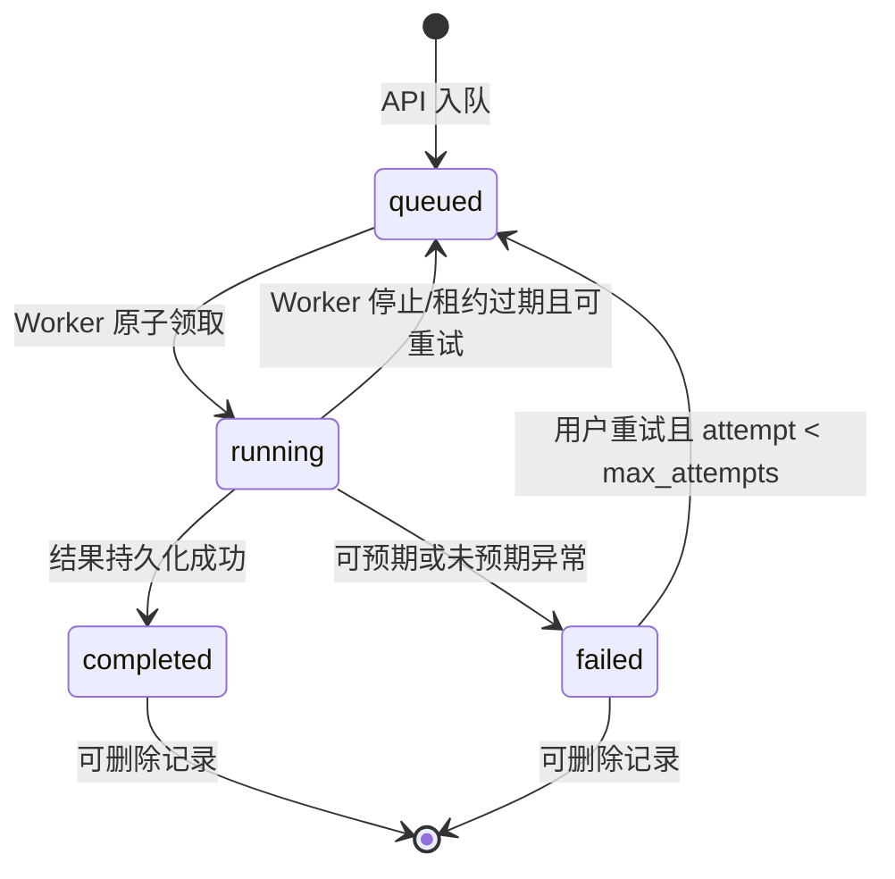

并发与恢复策略：

- PostgreSQL 是队列和状态真源，不依赖内存队列。
- `FOR UPDATE SKIP LOCKED` 支持多 Worker 安全领取。
- 部分唯一索引禁止同一资源同时存在两个活动任务。
- `heartbeat_at` 是租约依据；启动时和运行中定期恢复过期任务。
- 单 Worker 串行执行以保护本地 CPU/GPU/内存；可通过增加 Worker 实例横向扩展领取能力。
- 进程关闭时当前任务重新排队，不把正常关机记为业务失败。

### 4.5 分块方法

主要代码：`app/services/chunking.py`。

支持三种引擎：

| 引擎 | 实现方式 | 适用场景 |
| --- | --- | --- |
| `heading` | 解析 Markdown H1-H6，维护标题面包屑，再在章节内切分 | 结构化指南，默认优先 |
| `recursive` | 优先在段落、句号、分号、问号、换行边界切分 | 标题结构弱但自然段完整 |
| `fixed` | 按目标/最大长度和 overlap 固定滑窗 | 基线实验或结构不可用文本 |

可配置 `target_chars`、`max_chars`、`min_chars`、`overlap`、`max_chunks`、标题层级、短章节合并、标题路径前置、表格/代码块保护。

关键行为：

- Pydantic 校验参数范围并规范化旧配置。
- Chunk 同时保留展示文本和 `embedding_text`；后者可附加标题路径增强向量语义。
- 表格与 fenced code block 在能放入一个 Chunk 时不被截断。
- 保留 `char_start/char_end` 与 `heading_path`，为引用定位和证据抽取提供来源坐标。
- 注册前可在真实 Markdown 上 dry-run，预览长度统计和实际 Chunk，不写数据库。

### 4.6 嵌入模型

主要代码：`app/services/embeddings.py`。

| Provider | 方案 |
| --- | --- |
| `medcpt` | 官方 Query Encoder + Article Encoder，本地加载，768 维 |
| `builtin/hash/offline` | BLAKE2b 特征哈希，确定性归一化向量，适合测试和离线回退 |
| `openai/openai-compatible/local` | 调用兼容 `/embeddings` HTTP 接口 |

MedCPT 实现：

- 文档编码使用 title/body pair，最多 512 token。
- 查询编码最多 64 token。
- 使用最后隐藏层 `[CLS]` 向量并做 L2 归一化。
- `device=auto` 优先 CUDA，否则 CPU。
- 查询与文献编码器分别下载到 `query-encoder`、`article-encoder`。
- 运行时以 `(repo_id, local_dir, device)` 缓存，并用异步锁防止并发重复加载。

### 4.7 知识库创建与蓝绿索引

主要代码：`app/api/knowledge_bases.py`、`app/services/indexing.py`、`app/services/qdrant_store.py`。

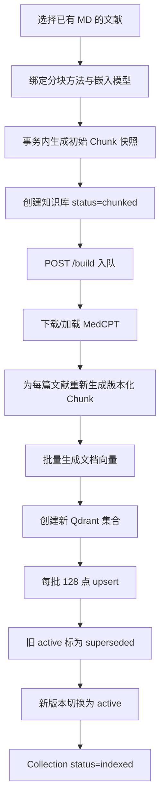

设计要点：

- 创建知识库时要求每篇文献已有 Markdown，先生成一个可预览的初始 Chunk 快照。
- 每次正式构建生成唯一 `IndexVersion` 和独立 Qdrant collection。
- PostgreSQL Chunk、向量和 Qdrant 全部写完后才切换 active，读取者在此之前继续使用旧版本。
- 旧版本保留为 `superseded`，可通过激活接口回滚。
- 删除知识库时先删除所有版本对应的 Qdrant collection，再删除 PostgreSQL 领域数据；Qdrant 删除失败则中止数据库删除。

### 4.8 混合检索

主要代码：`app/services/retrieval.py`。

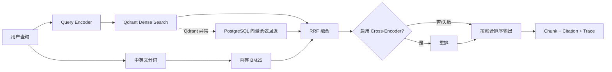

实现步骤：

1. 读取指定版本或 active `IndexVersion`。
2. 从 PostgreSQL 读取同版本 Chunk 和文档元数据，候选上限由配置控制。
3. Dense 路径使用 Query Encoder 生成查询向量并调用 Qdrant；异常时用 PostgreSQL 中保存的向量计算余弦相似度。
4. BM25 路径对英文词和中文双字切分，在当前候选快照内计算词法分数。
5. 通过 Reciprocal Rank Fusion 合并 Dense 和 BM25 排名。
6. 若配置 Cross-Encoder，则对融合候选重排；加载或推理失败时保留 RRF 结果。
7. 对最终评分做 min-max 归一化，应用 `minimum_score`，返回 `top_k`。
8. 返回向量分、BM25 分、RRF 分、重排分、版本、引用和逐阶段耗时 trace。

支持 `hybrid`、`dense`、`bm25` 三种策略。

### 4.9 Knowledge MCP

主要代码：`app/services/mcp_server.py`。

MCP 使用 Streamable HTTP，暴露三个只读、幂等工具：

| 工具 | 功能 |
| --- | --- |
| `list_knowledge_bases` | 列出知识库及索引状态 |
| `search_medical_knowledge` | 对指定知识库执行混合检索 |
| `get_knowledge_chunk` | 按 Chunk ID 读取精确正文与来源 |

工具返回结构化结果，Agent 使用服务名前缀形成无冲突工具名，如 `knowledge__search_medical_knowledge`。MCP 配置了 Host/Origin 白名单以防 DNS rebinding。

### 4.10 证据候选与人工审核

主要代码：`app/services/evidence_extraction.py`、`app/api/evidence.py`、`app/models/evidence.py`。

当前算法是确定性第一轮筛选：

- 按中英文句号、问号、感叹号和换行拆句。
- 长度限制为 12–1200 字符。
- 命中“推荐、建议、风险、死亡率、显著”等中英文证据标记时保留。
- 每个 Chunk 最多提取 3 个候选。
- 保存引用原文、Chunk、页码、全局字符偏移和 `pending` 审核状态。
- 审核接口写入 `ReviewDecision` 并把候选标为 `approved/rejected`。

注意：该功能代码已存在，但 `medical-knowledge-api/app/main.py` 当前没有 `include_router(evidence_router)`，因此相关 HTTP 接口实际上未暴露，前端也没有审核页面。详见第 10 节。

## 5. Agent：医学问答服务

### 5.1 前端工作区

`medical-agent-web/src/App.vue` 提供：

- 会话列表、新建会话、软删除会话。
- 模型连接新增、编辑、停用、设为默认。
- 选择本轮知识库和模型。
- Markdown 回答渲染与 `[n]` 引用上标。
- 运行检查器：模型、工具调用、检索 Chunk、当前引用、trace、核验状态。
- 无证据降级、数字不一致、无引用声明等风险标签。
- 会话恢复时重建工具结果和引用详情。
- 响应式桌面/移动布局。

前端 API 封装位于 `medical-agent-web/src/api.ts`。

### 5.2 会话与运行持久化

主要代码：`app/api/conversations.py`、`app/api/chat.py`、`app/models/agent.py`。

每轮问答的持久化关系为：

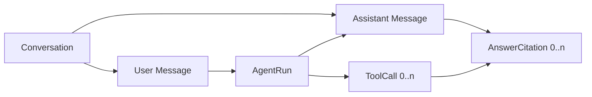

持久化内容包括：

- 会话所有者、标题、消息历史和软删除时间。
- 模型 provider/name、prompt/skill 版本、开始/结束时间、运行状态。
- 每次 MCP 调用的 server、tool、arguments、result、SHA-256、耗时和状态。
- 回答引用的文档、Chunk、索引版本、引用顺序和来源 Server。
- 检索 trace、核验结果、`degraded_without_evidence`。

读取会话详情时，后端从已保存的 ToolCall 结果重建引用标题、章节、页码、正文和分数，因此刷新页面后仍可查看当时证据。

### 5.3 模型配置与密钥

主要代码：`app/api/models.py`、`app/models/model_config.py`、`app/services/crypto.py`。

- 可保存 provider、model、base URL、max tokens、temperature、默认状态。
- API Key 使用 Fernet 加密后写入数据库。
- 响应只返回 `has_api_key`，不返回明文或密文。
- 没有用户配置时回退到环境变量模型。
- 同一时间只保留一个默认活动模型；删除是停用，若删除默认模型则自动选择替代项。

### 5.4 MCP 工具发现与隔离

主要代码：`app/services/mcp_client.py`。

支持 `stdio`、`sse` 和 `streamable-http` 三种 MCP transport：

1. 每轮请求创建 `MCPToolbox`，只连接 `enabled` Server。
2. 单个 MCP Server 连接失败只写日志，不阻断普通问答或其他 Server。
3. 完成 MCP initialize 后分页发现工具。
4. 只纳入 `allowed_tools` 白名单中的工具。
5. 对模型暴露的名称为 `<server>__<tool>`，同时保留原始工具名用于真实调用。
6. 优先使用 MCP `structured_content`；否则序列化普通内容块。
7. HTTP 客户端禁用系统代理继承，并把 connect/read/write/pool timeout 统一到 MCP 配置值。
8. transport 清理异常不会覆盖已经完成的回答或原始业务异常。

`app/services/mcp.py` 另有一个可并发调用显式工具列表的 `MCPOrchestrator`，但当前生产问答链路没有使用它，仅测试覆盖。

### 5.5 Agent 主循环

主要代码：`app/services/agent.py`、`app/services/harness.py`。

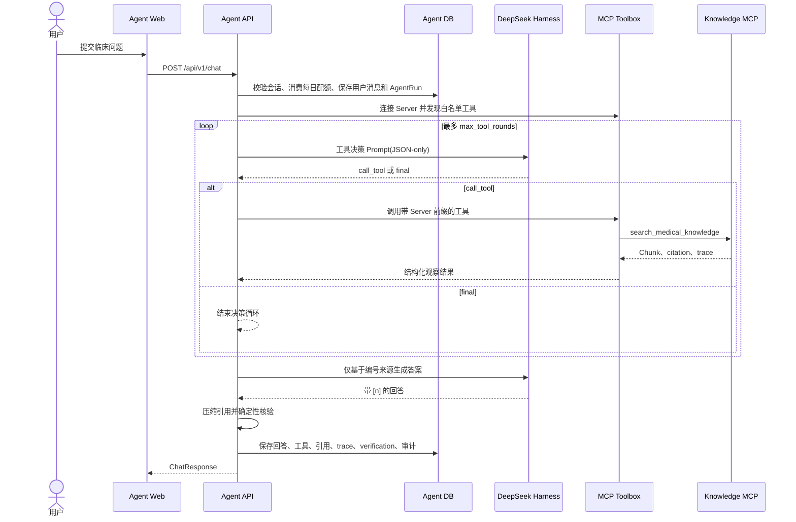

决策规则：

- 问候、致谢、界面操作可直接回答，并设置 `requires_evidence=false`。
- 疾病、诊断、治疗、药物、剂量、数值、风险、指南、临床决策必须先检索。
- 请求指定的 `collection_id` 会覆盖模型自行选择的知识库，防止越界检索。
- 工具名/参数无效时记录错误观察，并允许模型下一轮纠正。
- 达到最大轮次后，根据现有工具结果生成最终回答。
- 若没有工具或没有有效证据，回答附加“未经文献验证”提示并标记降级。

Harness 实现：

- DeepSeek Harness 是同步 SDK，通过 `asyncio.to_thread` 从 FastAPI 事件循环移出。
- 每个会话使用隔离工作目录 `workspace_root/harness/<conversation_id>`。
- 每次模型调用使用独立 Harness session ID。
- 系统 Prompt 通过 patch 和环境变量注入，强调循证、简洁和不可伪造引用。

### 5.6 引用生成与核验

主要代码：`app/services/verification.py`、`app/services/agent.py`。

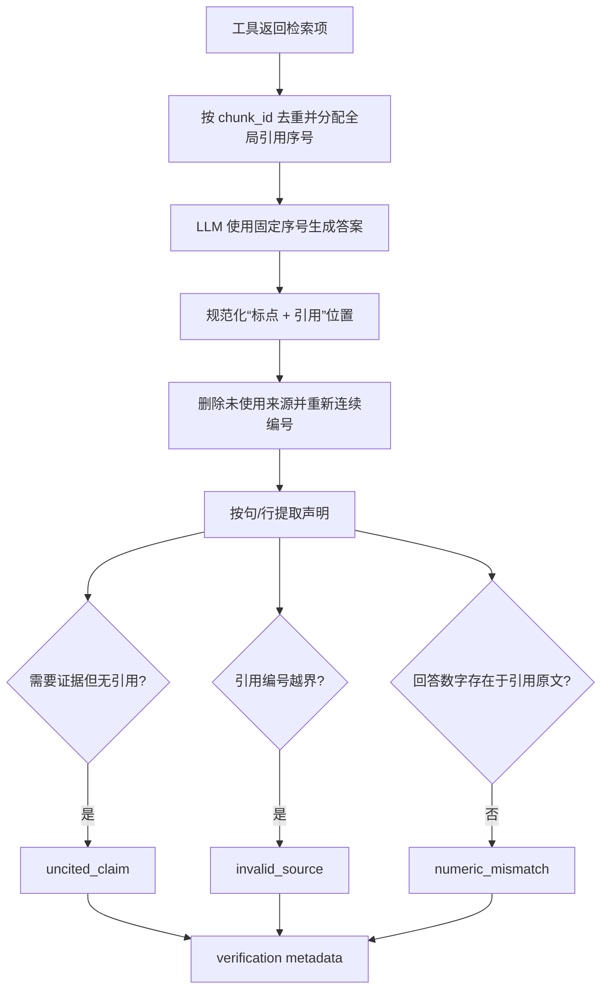

当前已实际运行的是确定性核验：

- 引用编号有效性。
- 长事实陈述是否带引用。
- 回答中的数字、百分比是否出现在对应证据原文中。
- 引用压缩后保证返回给前端的来源数组与答案编号一致。

前端已预留 `semantic_passed` 和逐 Claim 证据高亮 UI，但当前 `verification.py` 没有语义核验函数，Agent 也没有额外调用模型执行语义核验。相关测试仍期待该能力，属于代码/测试漂移。

### 5.7 权限、配额与审计

主要代码：`app/core/security.py`、`app/services/governance.py`、`app/api/governance.py`。

- 可选 API Key 鉴权，角色级别为 viewer、reviewer、editor、admin。
- 用户只能访问自己的会话，admin 可跨用户。
- 聊天使用 `SELECT ... FOR UPDATE` 原子消费每日配额，日期变化自动清零。
- 每次成功问答记录审计事件：知识库、模式、引用数、核验结果和降级状态。
- 普通用户只可读取自己的审计事件，admin 可读取全部。

## 6. Evaluation：题库与测评服务

### 6.1 前端工作区

`medical-evaluation-web/src/App.vue` 提供四个主视图：

| 视图 | 功能 |
| --- | --- |
| 全部题目 | 跨题库搜索和按题型/题库筛选 |
| 题库 | 创建题库、查看问答题/单选题统计和题目详情 |
| 生成题目 | 选择知识库、文献和最多 8 个 Chunk，生成并批量入库 |
| 测试执行 | 选择题库与知识库，执行全量测试并查看逐题结果 |

前端 API 封装位于 `medical-evaluation-web/src/api.ts`。

### 6.2 服务间集成

主要代码：`app/services/platform_client.py`。

Evaluation 明确不连接 Knowledge DB 或 Agent DB：

- `GET Knowledge /knowledge-bases` 获取可用知识库和文献。
- `GET Knowledge /knowledge-bases/{id}/documents/{id}/chunks` 获取持久化 Chunk。
- `POST Agent /conversations` 为每次生成或测试创建独立会话。
- `POST Agent /chat` 生成题目或回答测试题。
- 上游超时映射为 504，连接失败或上游异常映射为清晰的 502/404。

### 6.3 题库和题目

主要代码：`app/api/question_banks.py`、`app/models.py`。

- `Dataset` 代表题库，名称唯一，当前版本固定为 `1.0`。
- `Question` 支持 `qa` 和 `single_choice`。
- 题目保存标准答案、选项、正确选项、证据摘录、来源和扩展 metadata。
- 支持手工单题创建和生成题目批量写入。
- 支持跨题库按关键字和题型筛选。
- 删除题目为物理删除；暂未提供题库修改/删除接口。

### 6.4 从 Chunk 生成题目

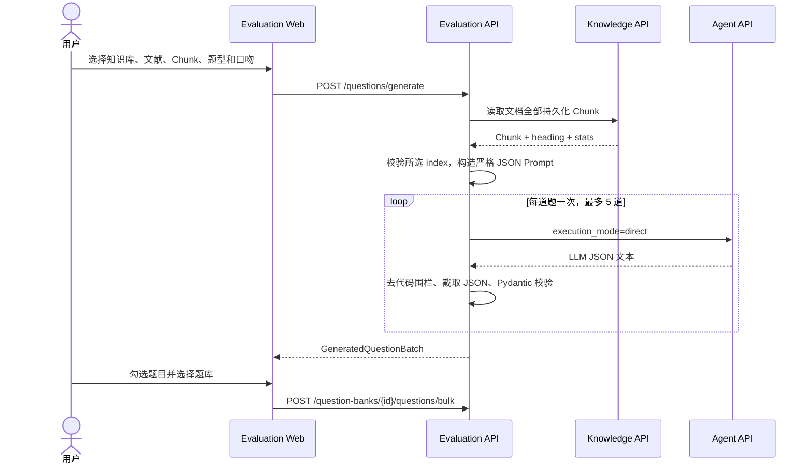

生成 Prompt 强制：

- 只能依据所选 Chunk。
- 证据 quote 必须逐字摘录并带 `chunk_index`。
- 问答题和四选一单选题分别使用固定 JSON 结构。
- 支持患者、临床医生、相关从业者、大众四种问题口吻。
- 多题生成时轮换“核心原则、适用条件、执行顺序、风险禁忌、推荐强度”等角度。
- 单题长度、答案长度、理由长度和证据条数受限。

### 6.5 题库测试

主要代码：`app/api/test_runs.py`。

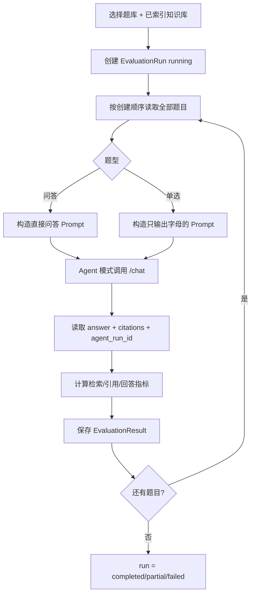

当前测试是 API 请求内同步逐题执行，每完成一题提交一次数据库，确保中途失败时已完成结果不丢失。单题上游失败会写入失败结果并继续下一题。

### 6.6 三层透明评分

主要代码：`app/services/evaluation.py`。

| 层 | 指标 | 计算方式 |
| --- | --- | --- |
| 检索 | Hit@K | 前 K 个引用是否包含任一预期文档 |
| 检索 | Recall@K | 命中的预期文档数 / 预期文档总数 |
| 检索 | MRR@K | 第一个预期文档排名的倒数 |
| 引用 | Claim Coverage | 带引用声明数 / 声明总数 |
| 引用 | Citation Validity | 有效引用编号数 / 全部引用编号数 |
| 引用 | Numeric Grounding | 数字能在对应引用原文找到的声明比例 |
| 回答 | Token Precision/Recall/F1 | 中英文 token 集合与标准答案的重合度 |
| 单选 | Choice Accuracy | 从回答抽取字母或选项文本并与正确项比较 |

总分是所有可用层分数的平均值。门禁规则为：

- 引用分数至少 0.8；
- 检索和回答分数在存在标签时至少 0.5；
- 单选题用 Choice Accuracy 替换普通答案 F1。

## 7. 数据模型关系

### 7.1 Knowledge 数据模型

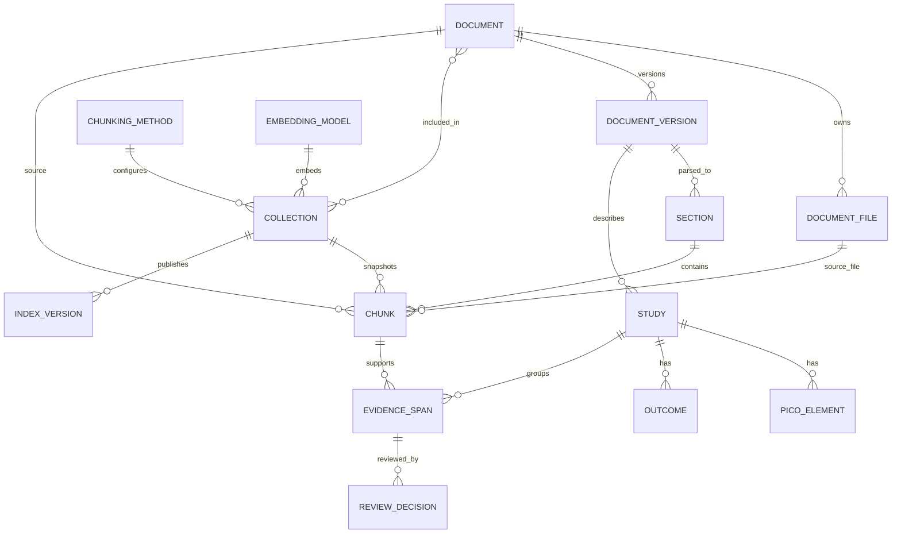

### 7.2 Agent 与 Evaluation 数据模型

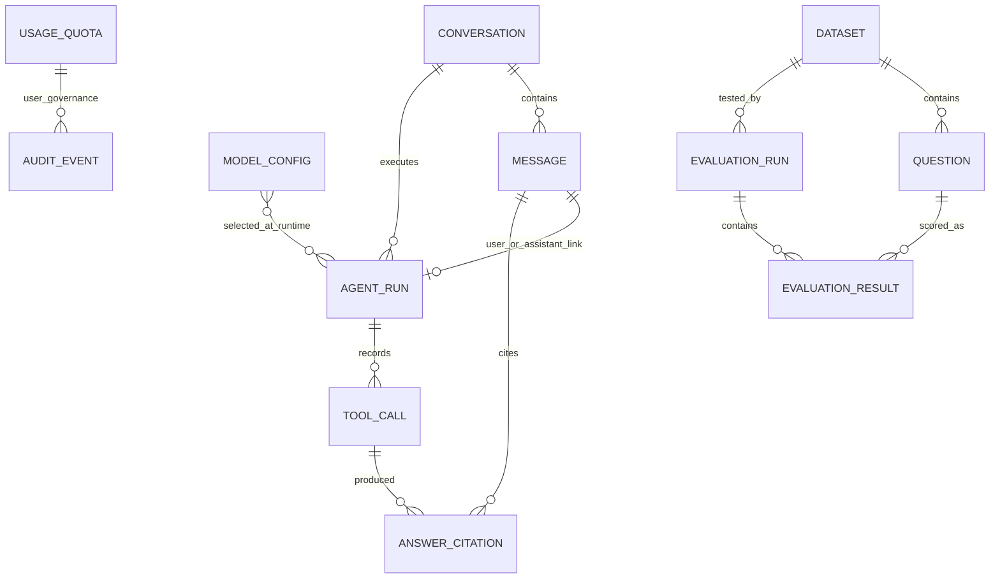

说明：`MODEL_CONFIG` 与 `AGENT_RUN`、`USAGE_QUOTA` 与 `AUDIT_EVENT` 在概念上相关，但当前数据库没有直接外键；运行记录保存模型名称/provider，审计通过 `user_id` 关联。

## 8. 可观测性与安全

### 8.1 可观测性

三个 API 复用同样的 Prometheus ASGI 中间件：

- `medical_http_requests_total{service,method,route,status}`
- `medical_http_request_duration_seconds{service,method,route}`
- `medical_http_requests_in_progress{service}`

路由标签优先使用 FastAPI 模板路径，避免 UUID 等动态值导致高基数。Prometheus 通过 Compose `observability` profile 可选启动。

### 8.2 安全边界

- Knowledge 和 Agent 都支持可选 API Key 与角色等级。
- Agent 额外执行用户隔离和每日配额。
- 模型 API Key 只以 Fernet 密文落库。
- 附件路径执行根目录约束，防止读取/删除工作区之外文件。
- MCP 工具使用白名单，模型不能调用未发现或未授权工具。
- 检索知识库由服务端请求上下文强制覆盖，模型不能通过参数逃逸到其他知识库。
- 引用核验采用 fail-closed：存在无引用事实、无效编号或数字不一致时标为未通过/降级。

## 9. 接口能力索引

### 9.1 Knowledge API

| 功能组 | 接口摘要 |
| --- | --- |
| 健康 | `GET /health`、`GET /ready`、`GET /metrics/` |
| 文献 | 创建、列表、详情、更新、删除、批量上传、批量删除未保护文献 |
| 附件 | 增加、预览/下载、移动、删除、PDF 转 MD |
| 配置 | 分块方法列表/预览/注册/删除；嵌入模型列表/注册/下载/删除 |
| 知识库 | 列表、创建、详情、构建、搜索、删除、文档 Chunk 预览 |
| 索引版本 | 列表、激活历史版本 |
| 任务 | 列表、详情、重试、删除、批量删除/隐藏历史 |
| MCP | `/mcp/` 三个只读工具 |
| 证据 | 抽取、候选列表、审核；代码存在但当前未挂载 |

### 9.2 Agent API

| 功能组 | 接口摘要 |
| --- | --- |
| 会话 | 创建、列表、详情、软删除 |
| 问答 | `POST /api/v1/chat` |
| 模型 | 列表、创建、更新、停用 |
| 元数据 | 模型 profile、启用的 Agent skill |
| 治理 | 使用量、审计事件 |
| 运行 | 按 run ID 读取 trace 与 verification |

### 9.3 Evaluation API

| 功能组 | 接口摘要 |
| --- | --- |
| 工作台 | 知识库列表、文档 Chunk、题目生成 |
| 题库 | 列表、创建、详情 |
| 题目 | 跨题库列表/过滤、单条创建、批量创建、删除 |
| 测试 | 创建测试、最近测试、测试详情 |
| 独立评分 | `POST /api/v1/evaluations/score` |

## 10. 当前实现差距与风险

### 10.1 优先级总览

| 优先级 | 问题 | 影响 | 建议 |
| --- | --- | --- | --- |
| P0 | Agent 语义核验实现缺失，但测试和前端仍期待 `validate_semantic_verification`、`semantic_passed`、claims | Agent 测试收集失败；前端逐 Claim 高亮永远没有真实数据 | 恢复语义核验实现或同步删除失效测试/UI 契约，二选一后统一 API schema |
| P0 | Evidence Router 未在 Knowledge `main.py` 挂载 | 证据抽取和审核接口不可访问，任务类型也无法从公开 API 正常入队 | 导入并 `include_router(evidence_router, prefix="/api/v1")`，补路由测试与前端入口 |
| P1 | README 宣称 Agent 支持 SSE，但 `/chat` 是普通同步 JSON 响应；`sse-starlette` 未使用 | 长模型请求期间无增量反馈，文档与实现不一致 | 实现独立 SSE endpoint，或修正文档和依赖 |
| P1 | Evaluation 声明 Celery/Redis 依赖，但测试运行在 HTTP 请求内同步逐题执行，Redis 没有业务使用 | 大题库会占用请求连接，重启后不能自动续跑 | 将 EvaluationRun 拆成持久化队列/Worker，或移除未使用依赖并明确同步上限 |
| P1 | Evaluation 与三个 Web 客户端没有向上游传 API Key | 启用 Agent/Knowledge 鉴权后，页面和评测链路会失败 | 增加服务间凭据和浏览器认证策略，禁止把管理员 Key 暴露给前端 |
| P1 | 模型 `temperature` 可在 UI/DB 配置，但 `HarnessService` 未传给 `DeepSeekHarness` | 用户设置不生效 | 在 SDK 支持时透传；否则从 UI/API schema 移除或明确只读 |
| P2 | 每次知识库重建保留完整 PostgreSQL Chunk/向量和 Qdrant collection，没有版本保留策略 | 长期重建会持续增长存储 | 增加保留数量、手动清理和容量指标；至少保留 active + 最近 N 个 |
| P2 | Knowledge Web 生产 JS 单包约 1.21 MB（gzip 394.95 kB），构建出现 >500 kB 警告 | 首屏加载与缓存更新成本偏高 | 按路由/对话框动态加载，拆 Element Plus/Markdown vendor chunk |
| P2 | `MCPOrchestrator` 仅测试使用，生产使用 `MCPToolbox` | 两套抽象容易分叉 | 合并为单一 MCP 编排层或标记前者为实验代码 |
| P2 | Evaluation 暂无题库编辑/删除、测试取消/重试、分页 | 数据量增大后运维体验不足 | 补 CRUD、分页和运行控制 |

### 10.2 本次验证结果

执行日期：2026-10-26。

| 检查 | 结果 | 说明 |
| --- | --- | --- |
| Knowledge Web `npm run build` | 通过，有大包警告 | 1619 modules；主 JS 约 1.21 MB |
| Agent Web `npm run build` | 通过 | 主 JS 约 173 kB |
| Evaluation Web `npm run build` | 通过 | 主 JS 约 106 kB |
| Evaluation API `pytest -q` | 通过 | 9 passed |
| Knowledge API `pytest -q` | 当前解释器收集失败 | 环境中的 `mcp` 不提供代码需要的 `MCPServer`；项目锁文件声明 `mcp>=2.3,<3`，应在项目隔离环境复验 |
| Agent API `pytest -q` | 收集失败 | 当前解释器缺少声明依赖 `httpx2`；另有真实代码漂移：测试导入不存在的 `validate_semantic_verification` |

环境缺包/版本不匹配不等同于业务代码失败；但语义核验函数缺失是源代码与测试契约之间的确定性不一致。

## 11. 建议的落地顺序

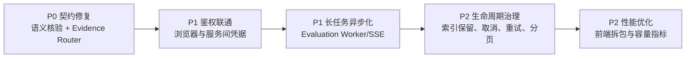

建议依次完成：

1. 先恢复可测试状态：统一 Agent 语义核验契约，挂载 Evidence Router。
2. 再做安全闭环：明确网关、浏览器、Evaluation 到 Agent/Knowledge 的认证方式。
3. 把长耗时执行移出同步 HTTP：题库测试使用持久化运行队列，Agent 增加可选 SSE 事件流。
4. 增加索引版本清理、测试运行取消/重试和大列表分页。
5. 最后处理前端拆包、监控面板和容量告警。

## 12. 关键源码导航

| 主题 | 文件 |
| --- | --- |
| Knowledge 应用装配 | `medical-knowledge-api/app/main.py` |
| 文献与附件 | `medical-knowledge-api/app/api/documents.py` |
| 分块 | `medical-knowledge-api/app/services/chunking.py` |
| MedCPT/嵌入 | `medical-knowledge-api/app/services/embeddings.py` |
| 蓝绿索引 | `medical-knowledge-api/app/services/indexing.py` |
| 混合检索 | `medical-knowledge-api/app/services/retrieval.py` |
| 持久化任务 | `medical-knowledge-api/app/services/task_worker.py` |
| Knowledge MCP | `medical-knowledge-api/app/services/mcp_server.py` |
| Agent 主循环 | `medical-agent-api/app/services/agent.py` |
| MCP 客户端 | `medical-agent-api/app/services/mcp_client.py` |
| 引用核验 | `medical-agent-api/app/services/verification.py` |
| Agent 请求编排 | `medical-agent-api/app/api/chat.py` |
| Evaluation 上游客户端 | `medical-evaluation-api/app/services/platform_client.py` |
| 题目生成 | `medical-evaluation-api/app/api/workbench.py` |
| 批量测试 | `medical-evaluation-api/app/api/test_runs.py` |
| 三层评分 | `medical-evaluation-api/app/services/evaluation.py` |
| 集成部署 | `medical-platform-deploy/compose.yaml`、`nginx.conf` |

